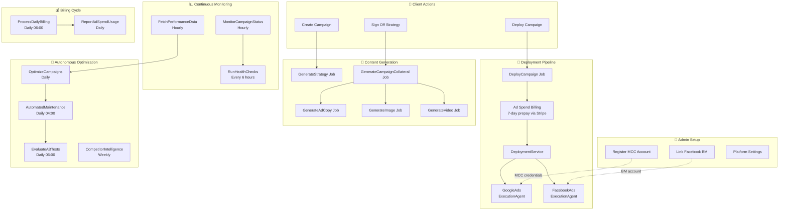
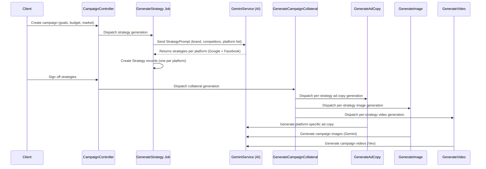
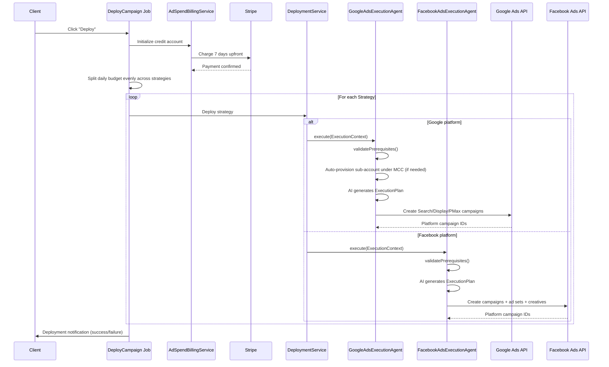
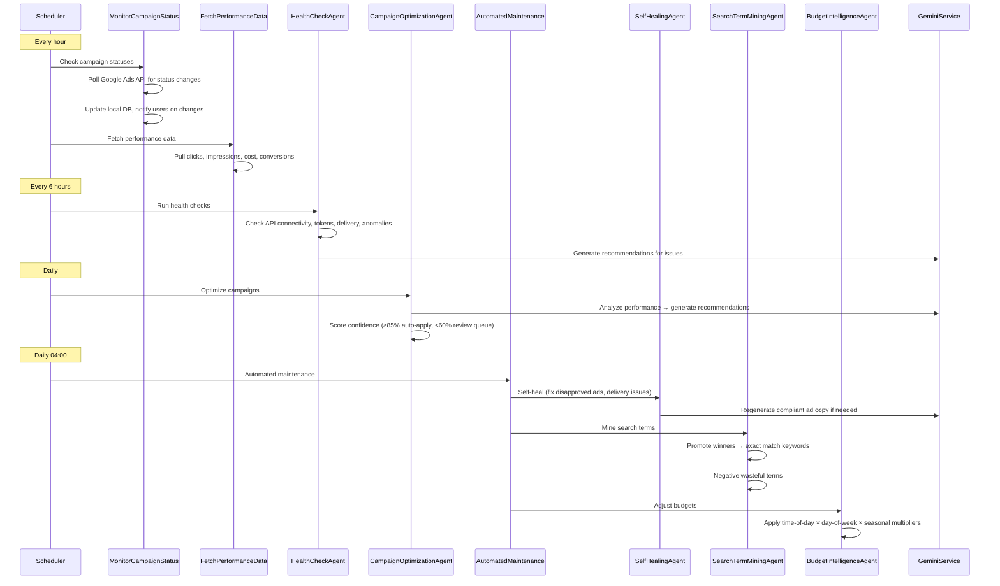
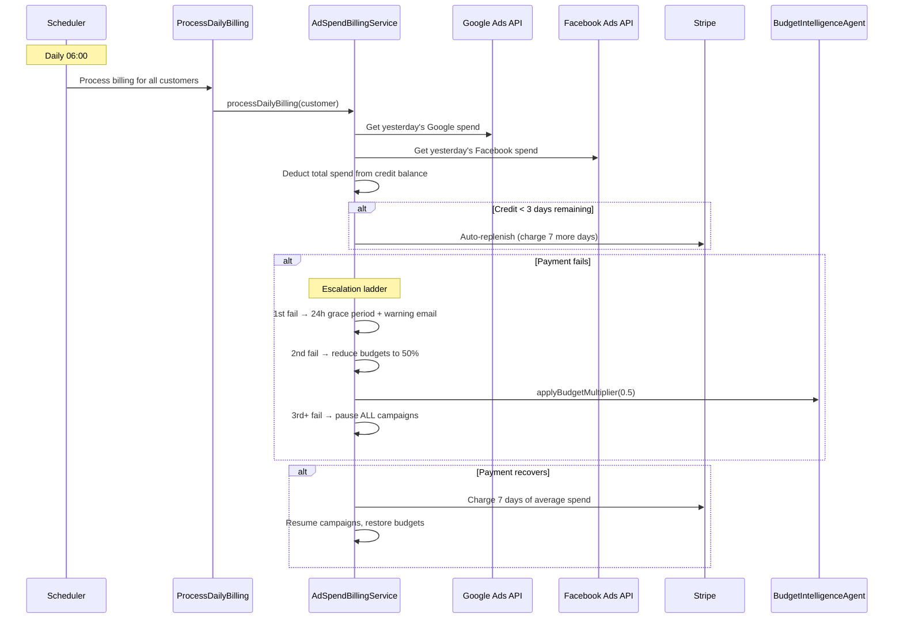
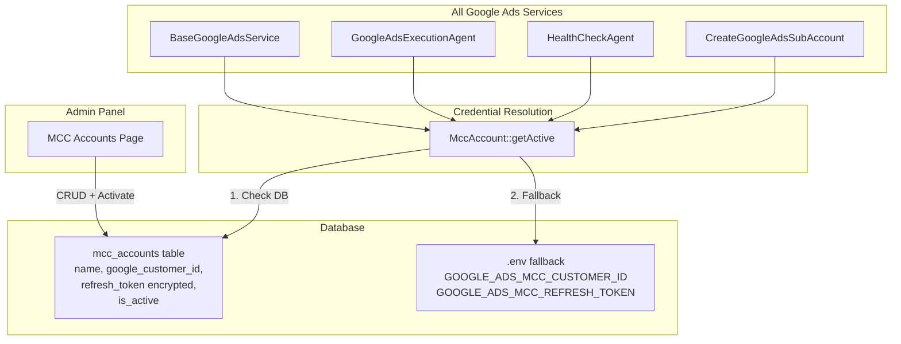
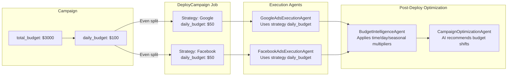
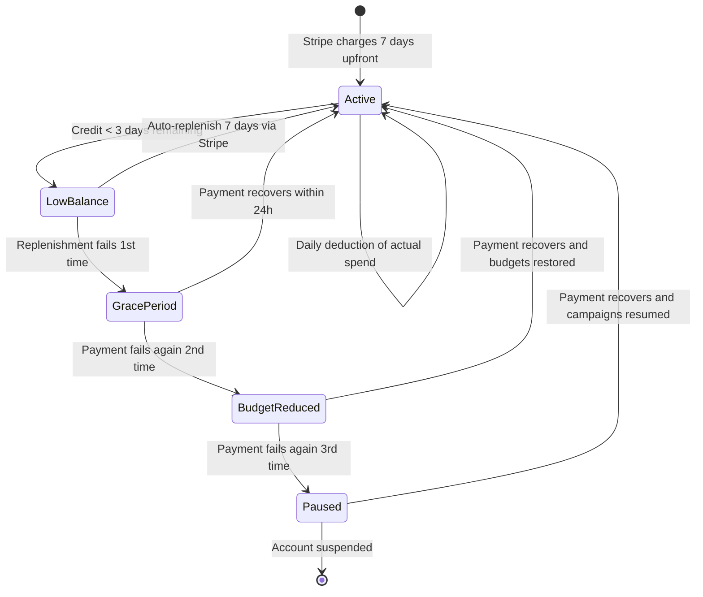

# Spectra Media Agent — System Architecture

> A complete guide to the autonomous advertising platform: every agent, job, and service, and how they fit together.

## High-Level Overview

Spectra is an AI-powered advertising agency platform. Clients create campaigns, and the system autonomously deploys ads across Google and Facebook, monitors performance, optimises spend, heals broken ads, mines keywords, runs A/B tests, and handles billing — all without human intervention after initial setup.

### Google Search delivery checks

Search deployment and repairs that expand keyword reach must verify Google historical demand and a fresh forecast against the actual match types, approved budget, CPC ceiling, markets, languages and negative keywords. Missing demand estimates remain unknown, never zero. Unavailable, stale or incomplete forecasts block the change for review, as do forecasts below the configured useful-traffic threshold. Historical top-of-page bids are estimates, not minimum bids. Forecast periods fit both approved and live campaign serving dates, including scheduled starts. Bounded trials also require estimated spend to fit the remaining reported-spend review threshold; that threshold is not a hard billing cap.

New Search campaigns are built paused and enabled only after the completed build passes another reach check and Google confirms activation. An enabled campaign cannot be altered through a deployment retry. Keyword mining, expansion, quality-score pruning and converting DSA-term promotion assess the complete resulting keyword set before changes. Automatic creation of a separate DSA campaign requires its own approved funding and a forecast that represents its URL targeting, so it remains held for review.

The hourly Search watchdog also runs `GoogleSearchCostProtection` before assessing delivery. Approved market research retains ongoing CPC and daily-budget limits in `spend_guardrails.automation_limits`; these limits do not suspend management like a fixed-spend trial does. Without an explicit CPC ceiling, initial research limits candidates to one fifth of the proposed daily allocation. Active managed campaigns with AutoHealing enabled can have excessive inherited ad-group and explicit keyword bids lowered to their approved ceiling. This protective path never adds keywords, increases bids or budgets, changes bidding strategy, or enables paused entities. It validates the atomic request, journals the attempt before writing and verifies the live result; ambiguous outcomes are read back rather than automatically replayed. Missing approval, unsupported bid amplification and spending holds require review. A verified ceiling does not establish that affordable traffic is available.

Spend-based search-term waste checks run before the impression floor and use a budget-relative threshold, at least two matured clicks and no recent primary or secondary conversion evidence. Google account dates exclude the full conversion-lag period; an expensive new click alone cannot justify an exclusion. Sparse exclusions and low-conversion promotions use exact match. Cost incidents can trigger Google-only mining from the hourly job, at most once per day. Pure protective exact exclusions independently re-read term evidence, verify ongoing limits and reject positive-keyword conflicts. Their full-portfolio demand and positive traffic estimate must still fit the approved budget and useful-traffic threshold; only Google's disclosed inability to model negatives is tolerated. The result permits cost containment, not a claim that remaining reach is verified. Mixed changes and expansion retain the ordinary forecast gate, and uncertain outcomes remain visible for review.

Google Ads API v24+ forecasts cannot model negative keywords. Ordinary initial launches can use a fresh indicative forecast with that sole, structured limitation after verifying the retained negatives' scope and checking for direct keyword conflicts. The limitation remains visible and actual traffic may be lower. Unknown limitations, changed settings, zero forecast traffic and excess spend still block launch. A customer can approve a fresh positive forecast with limited traffic after seeing its estimates. Controlled trials and ordinary mutation paths retain their stricter evidence requirements.

Approved ongoing automation can test up to three researched exact/phrase additions through the explicit bounded-expansion gate. It independently checks demand, current and proposed whole-portfolio forecasts, useful traffic and material improvement, unchanged negatives and approved spending limits. Only the disclosed negative-keyword limitation is tolerated; bids, budget, status and serving dates cannot expand. A durable attempt and readback precede live traffic verification. The observation window follows the forecast click rate and must fit the campaign's remaining dates. An unsuccessful verified test pauses only its new keywords; unknown rollback outcomes remain blocked rather than replaying writes.

Affordable discovery balances its forecast quota across measured cost, positive search demand and independently reviewed commercial category heads, removing canonical close-variant duplicates. Historical prices above the approved bid do not exclude a relevant category from a capped forecast. Several expensive aliases or a tiny positive forecast do not end research: one additional commercial-theme pass receives the actual CPC/budget bounds and failed estimates. It translates the offer into established buying categories rather than inventing ever-longer package descriptions. Idea discovery examines a bounded larger pool and reviews relevance in small validated batches; unavailable reviews remain unknown and unreviewed ideas cannot be admitted. Seed matches also require independent review in this pass. Unknown prices never count as free traffic, and unmeasured seed fallbacks cannot establish affordable demand. Manual CPC additions carry their actual inherited bid into forecasts. Preapproval research compares the rescued portfolios at the same limits before recommending a limited-traffic proposal.

Every initial Search build, including managed accounts and one-time handovers, replaces Google's unset Manual CPC default with an explicit bid supported by fresh keyword cost and reach estimates. It forecasts every candidate in a bounded historical-cost pool, then tests up to two lower midpoint bids because top-of-page prices are not minimum auction bids. Among forecasts meeting the useful-traffic threshold, it favours lower estimated average CPC inside the approved allocation and any lower CPC limit. Candidates within 5% of the lowest average CPC compete on traffic; near-identical traffic favours lower total cost and bid. A daily budget is a ceiling, not a target to exhaust. The bid is written only to a freshly verified paused campaign and read back without changing budget, targeting or status. Missing estimates require review; existing explicit bids are preserved. A bid estimate does not certify activation or conversion tracking. Display cannot use Search keyword forecasts: unspecified Manual CPC is held for review, while supported conversion bidding is prepared paused and is not recorded as a live launch.

Campaign market research precedes approval in every saved campaign flow: manual wizard, generated campaigns, managed plans and setup handovers. Strategy generation finishes before the research and budget-choice panel appears. `ResearchCampaignMarket` runs after strategy generation commits. `CampaignMarketResearch` researches the business offer and selected keywords, then tests relevant alternatives, keyword-cost-derived CPC candidates and daily budgets. Google Search proposals use the real customer account's currency and timezone and the selected markets and match types. Forecasts contain totals for their stated future dates; they are never linearly scaled website previews. A ready proposal means its estimates are complete, not that traffic or purchases are guaranteed. Positive forecasts below the traffic benchmark remain visible with a limited-traffic advisory and can be explicitly approved.

For new campaigns, budget comparisons are anchored to the starting or custom research amount and include lower and higher amounts with independently checked forecasts. The exact reference remains the default when it has valid evidence; unavailable comparisons are shown without a selectable proposal. Research never replaces the owner's chosen amount merely to pass the traffic benchmark. If no candidate meets that benchmark, the limited-traffic fallback favours the most forecast clicks inside the researched budget, using lower cost to break near ties. This avoids presenting a nearly empty forecast as preferable solely because its average CPC is low.

Keyword discovery includes ordinary buying terms for the actual product or service alongside differentiated phrases. Sparse Planner results or failed traffic forecasts can trigger one additional category discovery pass, retaining relevance review and existing CPC limits. These alternatives compete at the current daily budget before the agents recommend more spend. A researched recommendation for an existing platform campaign remains separate from permission to apply its changes.

Research never edits approved spend, keywords, platform bids or campaign status. The customer explicitly accepts the displayed keyword/bid/allocation proposal and its exact daily total; stale requests and changed inputs cannot approve it. Budget approval, strategy sign-off, funding, queued deployment and direct deployment share that boundary. Existing platform repairs retain their own safety checks. New targeting or business inputs require new research; eventual launch still checks the actual staged campaign.

The customer can research another hypothetical daily amount without saving or approving it. A new Search proposal explicitly names Manual CPC; accepting it cannot silently switch to conversion bidding during construction. Fresh initial-bid setup respects both the accepted starting-bid limit and any existing lower owner CPC cap. Future conversion-backed bidding changes remain a separate decision.

For a single Google Search placement, automatic research compares up to three researched daily-budget options using the same researched keywords and an independently researched CPC for each budget. The agents compare category terms, practical buying-intent phrases, their combined selection and a separate lower-cost subset against the campaign's offer and target market. The lower-cost subset requires relevance, measured demand and a positive historical cost; unknown prices never count as free traffic. Keyword discovery uses the language of customer tasks and purchase decisions, rather than relying on product-feature jargon. Every selected amount and bid has its own Google forecast; larger budgets never inherit linearly multiplied traffic. The customer can compare maximum CPC, estimated average CPC (forecast spend divided by unrounded clicks), indicative period clicks and estimated spend, then explicitly approve the selected option. Approval binds its exact quote ID, request, inputs, bid and amount and retains the chosen forecast in the approved plan. Existing platform campaigns still require separate review before any proposal is applied. A visible custom-budget flow researches amounts such as 50/day without changing saved spending; a single existing Search campaign receives a hypothetical quote while its actual allocation stays unchanged. Pre-deployment research does not create a delivery-health warning.

Execution uses the reviewed campaign placement. An AI plan cannot replace Search with Display or Performance Max, and construction does not automatically upgrade a reviewed campaign to Performance Max. A different placement needs a separate researched proposal and approval.

Every strategy is assessed, with provider coverage explicit. Google Search has account-scoped cost/reach estimation; other platforms and formats receive business/keyword research and require review until a platform-specific provider can verify their pricing and reach. Google's demand is never presented as Facebook, Microsoft or LinkedIn pricing. Additional providers implement `CampaignMarketResearchProvider` and register under `campaign.market_research.providers`. Missing accounts or unusable estimates cannot silently approve a campaign. Paid customers can prepare their managed account before research; free automatic previews create no platform account without explicit preparation intent.

`DispatchGoogleSearchDeliveryChecks` queues an independent check for each deployed Search campaign every hour. `GoogleSearchReachRecovery` excludes the partial restart hour and three hours of reporting lag, uses the latest 48 complete hours for ordinary checks, and resets its evidence after a material configuration change. It researches low reach after 12 complete reporting hours, even during a controlled test or spending hold; a verified insufficient forecast can trigger read-only research earlier. Research does not require an arbitrary minimum keyword count or prior conversions. With approved ongoing limits, an insufficient capped forecast takes priority over starting another ad-rank repair. Existing repair attempts keep their own verification and readback workflow.

Only managed campaigns with AutoHealing, a confirmed budget, a verified positive live CPC ceiling and faithful improved forecasts can receive an automatic keyword repair. It adds at most three relevant, negative-safe exact/phrase keywords, once per seven days. It never increases bids or budgets, widens locations, changes goals, uses broad match, or restarts paused campaigns. Controlled trials require owner review. Failed or partial writes retain a durable attempt and an unresolved state.

Google must confirm the additions and report subsequent Search impressions and useful clicks before a repair is marked recovered. A few impressions without clicks remain `low_traffic`. The default verification window is 24 complete reporting hours; a bounded expansion uses a longer forecast-paced window when needed, within the remaining serving dates. Bounded verification retains its full trial history, including early primary conversions, for up to seven days. An unsuccessful bounded test rolls back its new keywords and escalates for review. Campaign pages show the measured period, actual results, separate forecasts and proposals; stale or unavailable checks cannot remain healthy. Defaults live in `optimization.search_delivery`.

Ad Rank has a separate repair path from Ad Strength feedback. The watchdog diagnoses sustained rank-related impression loss from complete account days after the current settings took effect. It stages evidence-reviewed RSA copy and assets paused, retains the working ad while Google reviews replacements, and verifies activation before retiring old resources. Actual rank and click evidence must improve before recovery is confirmed. Budget, bids, targeting, keywords and campaign pause states are preserved. Bounded trials require explicit creative-repair permission and fresh remaining-spend checks; that permission does not unlock legacy in-place copy writers or other optimizers.

Creative staging saves the complete reviewed plan before submission and adds two assets per check. Only acknowledged, scoped, paused assets can resume; uncertain writes require review and cannot be blindly recreated or activated. SDK repair mutations have a 30-second deadline without automatic retries. Partial submissions never count as traffic recovery.

Confirmed read-only Google quota rejections preserve the pending plan and resource IDs and defer checks until the API cooldown expires. The cooldown does not certify new delivery or spending evidence. Uncertain writes still require review. Paused preparation uses fresh financial and ownership checks with fewer repeated reads; serving activation retains the full configuration checks.

Approved assets activate in batches of at most two replacement pairs per check. Each completed pair has durable, scoped status and content readbacks; an unfinished write cannot be replayed. The original RSA stays enabled until the full asset plan and final replacement swap pass verification.

Budget health and pacing emails compare complete account days since the current platform budget was confirmed. Desired local edits cannot establish that history: failed changes remain unverified, and a later successful retry begins a new comparison window. A bounded trial reports fresh Google lifetime spend minus its immutable pre-trial baseline, with the remaining review threshold shown separately. Earlier spend is never projected against a reduced budget. Unknown budget history or unavailable spend remains unverified; pacing comparisons are not monthly billing limits. The separate spend-safety job still verifies trial settings and stop conditions every 15 minutes.

---

## The Complete Workflow

### Phase 1: Campaign Creation & Content Generation

### Phase 2: Deployment & Billing

### Phase 3: Continuous Monitoring & Optimization

### Phase 4: Billing Cycle

---

## Agent Inventory

### Deployment Agents

| Agent | Trigger | Purpose |
|-------|---------|---------|
| **GoogleAdsExecutionAgent** | `DeployCampaign` job | AI-powered Google Ads deployment — creates Search, Display, PMax, and Video campaigns. Auto-provisions sub-accounts under MCC. |
| **FacebookAdsExecutionAgent** | `DeployCampaign` job | AI-powered Facebook/Meta deployment — handles Dynamic Creative, Advantage+, carousel/video ads. |

### Optimization Agents

| Agent | Trigger | Purpose |
|-------|---------|---------|
| **CampaignOptimizationAgent** | Daily `OptimizeCampaigns` job | Plan-aware daily or weekly analysis, using calendar days so completion-time drift cannot skip a run. Reads live bidding configuration and rejects ineffective keyword CPC changes under automated bidding. Bounded trials and spending holds remain read-only. |
| **BudgetIntelligenceAgent** | Daily 04:00 `AutomatedMaintenance` job | Rule-based budget adjustments using time-of-day, day-of-week, and seasonal multipliers from config. Also called by billing on payment failure. |
| **SearchTermMiningAgent** | Daily 04:00 `AutomatedMaintenance` job | Mines Google search term reports. Promotes high-CTR terms to exact match keywords, negates wasteful terms. |
| **SelfHealingAgent** | Daily 04:00 `AutomatedMaintenance` job | Detects and fixes ad issues: disapproved ads (AI-regenerates copy), budget problems, delivery issues. Retry with exponential backoff. |
| **ABTestingAgent** | Daily 06:00 `EvaluateABTests` job | Manages A/B tests on creative assets. Chi-squared significance testing at 95% confidence, auto-applies winners. |
| **CreativeIntelligenceAgent** | Manual | Analyses creative performance at asset level (headlines, descriptions, images). Identifies winners/losers and generates AI variations. |

### Intelligence Agents

| Agent | Trigger | Purpose |
|-------|---------|---------|
| **CompetitorIntelligenceAgent** | Weekly `RunCompetitorIntelligence` job | Orchestrator — coordinates discovery, analysis, auction insights, and counter-strategy generation. |
| **CompetitorDiscoveryAgent** | Called by CompetitorIntelligenceAgent | Uses Google Search API + Gemini to discover competitors based on customer's website and industry. |
| **CompetitorAnalysisAgent** | Called by CompetitorIntelligenceAgent | Scrapes competitor websites, extracts messaging/positioning/pricing via AI. |
| **AudienceIntelligenceAgent** | Manual | Manages Customer Match lists, audience segmentation, and lookalike audience recommendations. |

### Monitoring Agents

| Agent | Trigger | Purpose |
|-------|---------|---------|
| **HealthCheckAgent** | Every 6 hours `RunHealthChecks` job | Comprehensive health monitoring: API connectivity, token validity, campaign delivery, performance anomalies, budget pacing, creative fatigue, billing status. |
| **CheckGoogleCampaignReadiness** | Immediately after confirmed activation, five minutes after deployment, then hourly queued fan-out | Checks each strategy's Google campaign, repairs eligible Search ad strength, campaign conversion goals and audience Observation settings, and publishes verified evidence to customer and admin campaign pages. |
| **VerifyConversionTracking** | Weekly Sunday 04:00 | Reads active Google campaigns, selected conversion goals, exact action attribution and scoped server-side delivery failures. Records unavailable evidence as unknown; zero conversions alone do not trigger a tracking-fault email. |

Google Search deployment checks conversion-action configuration and provider validation before creating ads or enabling conversion bidding; this does not prove a conversion was attributed. Ongoing goal repairs use the strategy's declared intent and change only that campaign's goals. A selected secondary action uses a campaign-specific custom goal; account-wide primary flags and account defaults remain unchanged. Own-site signup and paid-subscription imports must pass Data Manager validation using the platform MCC credential, which needs both `adwords` and `datamanager` scopes.

Campaign-level spend protection runs every 15 minutes on the dedicated `spend-safety` Horizon queue, including single-ad-group campaigns. A confirmed platform pause creates a durable spending hold that automation and billing recovery cannot clear. Explicitly configured Search trials use integer-micro daily/CPC limits and a fresh lifetime-spend baseline; automatic changes remain suspended until review. The spending threshold is checked against Google's delayed reporting, so it is not a guaranteed billing cap. Ordinary zero-conversion checks exclude recent reporting days before acting.

Genuine registrations are recorded before upload dispatch, including registrations without an ad click identifier. Google click identifiers survive an expired session in an encrypted host/tenant-bound cookie for at most 30 days. A Google ingestion receipt means accepted for processing; delayed Data Manager diagnostics distinguish processing success, warnings and failures. Even processing success does not prove Google Ads attribution or a reported conversion. Validation-only checks create no conversion events.

The weekly conversion monitor keeps account activity separate from the campaign's selected action. A ready goal with no reported events remains unverified, even if another action reports conversions. Configuration issues and real failed imports produce scoped alerts with evidence and a public campaign link. The attempted import destination is saved before sending so a rejected first upload can be diagnosed without claiming Google accepted it.

Completed purchases carry the actual transaction ID, amount and currency. Reviewed purchase tags use those fields rather than counting a generic form submission or page visit as a sale. On our own checkout, `OwnSitePurchaseTracking` records positive, verified live setup payments and uses existing initial paid-subscription receipts. Zero-value promotions, renewals and unrelated payments are excluded. The signed webhook and verified checkout return share a durable receipt identity.

New verified setup payments with a Google click identifier use the canonical own-site Purchase import, shared with first subscription payments. The receipt pins the destination under `conversions.google_ads_customer_id` before queue dispatch, keeps its separate `paid_setup` transaction identity, and remains excluded from browser delivery even while an upload is pending or failed. A webhook replay cannot reroute an older browser receipt, and the installed browser binding remains unchanged. This is an own-site marketing-account policy: incoming clicks do not carry independently verified customer-account provenance, so it must not be used as a general router for campaigns advertising the same checkout from several Google accounts. Receipts without a click identifier retain the native browser path.

For an external website, publish `ecommerce.transaction_id`, `ecommerce.value` and `ecommerce.currency` in the data layer with its reviewed success event, after the checkout confirms payment. The managed Purchase tag requires a positive amount, a currency code and an order ID, and verifies those variable definitions in the published container. A confirmation-page trigger needs the same data available when it fires; visiting that page alone is insufficient.

An operator installs the own-site browser destination with `OwnSitePurchaseTracking::bindReviewedGoal()` after Google confirms the exact paused campaign and selected website Purchase action. The `own_site.purchase_tracking` setting binds its request, action, campaign and HTTPS origin; a customer claiming our domain cannot install a destination. Only the buyer's recent receipts completed after installation are exposed to that buyer's browser. Browser invocation, website installation and Google conversion attribution remain separate evidence. Changing the reviewed goal invalidates the installation until an operator checks it again; binding a destination never changes the campaign budget or pause state.

Ad strength repairs use Google's action items and reviewed copy, then reread policy and strength after Google's review. A successful update remains pending until Google confirms approved assets and GOOD or EXCELLENT strength. Repairs have durable retry limits and respect approval, billing, automation, campaign dates and pauses before writes. Policy and readiness failures are visible without automatically pausing the campaign.

Search audiences added as signals explicitly use audience Observation so they do not restrict search reach. Groups without attached audiences do not constrain reach by themselves. The hourly readiness check reads actual audience criteria and ad-group restrictions and repairs only eligible campaigns, while preserving explicit audience-only intent and every unrelated restriction. Audience, conversion-goal and ad-strength checks run independently, and unavailable checks retain the last known evidence.

---

## Scheduled Jobs Timeline

```mermaid
gantt
    title Daily Automation Schedule
    dateFormat HH:mm
    axisFormat %H:%M

    section Hourly
    MonitorCampaignStatus           :active, 00:00, 1h
    FetchPerformanceData            :active, 00:00, 1h
    CheckGoogleCampaignReadiness    :active, 00:00, 1h

    section Every 6 Hours
    RunHealthChecks                 :crit, 00:00, 30min
    RunHealthChecks                 :crit, 06:00, 30min
    RunHealthChecks                 :crit, 12:00, 30min
    RunHealthChecks                 :crit, 18:00, 30min

    section Daily
    OptimizeCampaigns               :done, 00:00, 2h
    CheckCampaignPolicyViolations   :done, 00:00, 1h

    section Daily 04:00
    SelfHealingAgent                :04:00, 30min
    SearchTermMiningAgent           :04:30, 30min
    BudgetIntelligenceAgent         :05:00, 30min

    section Daily 06:00
    ProcessDailyAdSpendBilling      :06:00, 1h
    EvaluateABTests                 :06:00, 30min
    ReportAdSpendUsage              :06:00, 15min
```

---

## MCC Account Management

All Google Ads operations run through a platform-owned MCC (Manager) account. Admins manage MCC accounts via **Admin > MCC Accounts**.

---

## Budget Flow

---

## Ad Spend Billing Lifecycle

---

## Key Configuration

### `config/budget_rules.php`

Controls the rule-based automation thresholds used by `BudgetIntelligenceAgent`, `SearchTermMiningAgent`, and `SelfHealingAgent`:

| Section | Examples |
|---------|----------|
| Time-of-day multipliers | 0.5× overnight, 1.0× business hours, 1.3× evening prime |
| Day-of-week multipliers | 0.8× Sunday, 1.0× midweek, 1.3× Friday |
| Seasonal multipliers | 2.0× Black Friday, 1.8× Cyber Monday |
| Self-healing rules | Max 3 fix attempts, 24h retry delay, min 0.5% CTR |
| Search term mining | Min 100 impressions, promote at 5% CTR, negative at $20 cost + 0 conversions |
| Budget reallocation | Min ROAS 1.5, max 20% shift per cycle, min 7 days data |

### `config/seasonal_strategies.php`

Presets for seasonal campaign adjustments used by `ApplySeasonalStrategyShift`:

| Season | Budget Multiplier | Bidding Strategy | Copy Theme |
|--------|-------------------|------------------|------------|
| Black Friday | 1.5× | TARGET_CPA | Urgency |
| Summer Sale | 1.2× | MAXIMIZE_CONVERSIONS | Summer |
| Default | 1.0× | MAXIMIZE_CONVERSIONS | Evergreen |

## Production frontend builds and deployment

GitHub Actions builds the frontend once on Node 22 and tests those assets with the
rest of the application. A successful `master` push publishes an immutable GitHub
prerelease named `frontend-<source SHA>-<CI run ID>-<attempt>`. The release contains
`frontend-build.tar.gz` and `receipt.json`. Only the publisher job can write releases;
pull requests never publish or deploy.

The separate **Deploy production** workflow runs after the entire CI workflow
succeeds. It ignores superseded commits and triggers Forge using the repository's
`FORGE_DEPLOY_HOOK` Actions secret. Forge's **Push to deploy must stay disabled**;
otherwise a push can start deployment before its assets or checks are ready.
Keep the Forge deployment script synchronized with
[`infrastructure/deploy/forge.sh`](infrastructure/deploy/forge.sh). Do not manually
pull on the server.

`bin/frontend-artifact install` downloads the build for the checked-out commit and
latest successful CI attempt. It checks GitHub's current master, the source tag,
receipt, archive checksum, public configuration fingerprint, safe archive paths and
Vite manifest references before installing anything. Missing assets, incomplete CI,
configuration drift or invalid evidence stop deployment before migrations and
activation. There is no production compilation or fallback to an older build.
Forge still runs locked `npm ci` because PDF generation requires Puppeteer.

Set the public repository variables `VITE_APP_NAME` and `VITE_STRIPE_KEY` to match
the production `.env`; **only a Stripe publishable `pk_live_…`/`pk_test_…` key belongs
there**. Never upload the production `.env` or a Stripe secret key. The allowlisted
exporter `php bin/frontend-build-config /path/to/.env` resolves those two settings
without booting Laravel or printing other values. Update both the production
settings and repository variables together, then run CI again. Pull request builds
use public test fixtures.

After Forge activates a release, `/build/deployment.json` identifies its exact source
and CI run. The deployment workflow waits for this receipt and `/up` before reporting
success. The existing live release keeps serving if any pre-activation step fails.
Public release downloads require no new credential on Forge; GitHub API outages or
rate limits fail closed. Retain release assets needed for redeployment; their GitHub
Actions transfer copy expires after seven days, but the published release does not.
If publication fails, use **Re-run all jobs** so the new attempt rebuilds and packages
its own matching artifact; a partial rerun cannot reuse another attempt’s receipt.
A rollback to an older commit should be reverted onto `master` and pass CI again.
